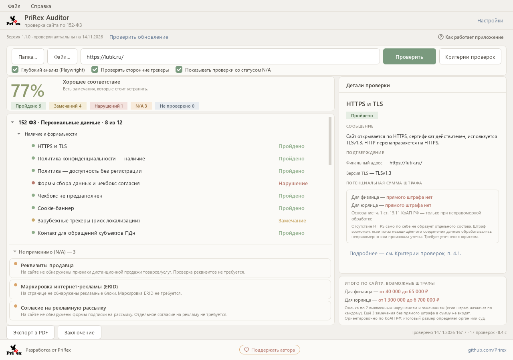
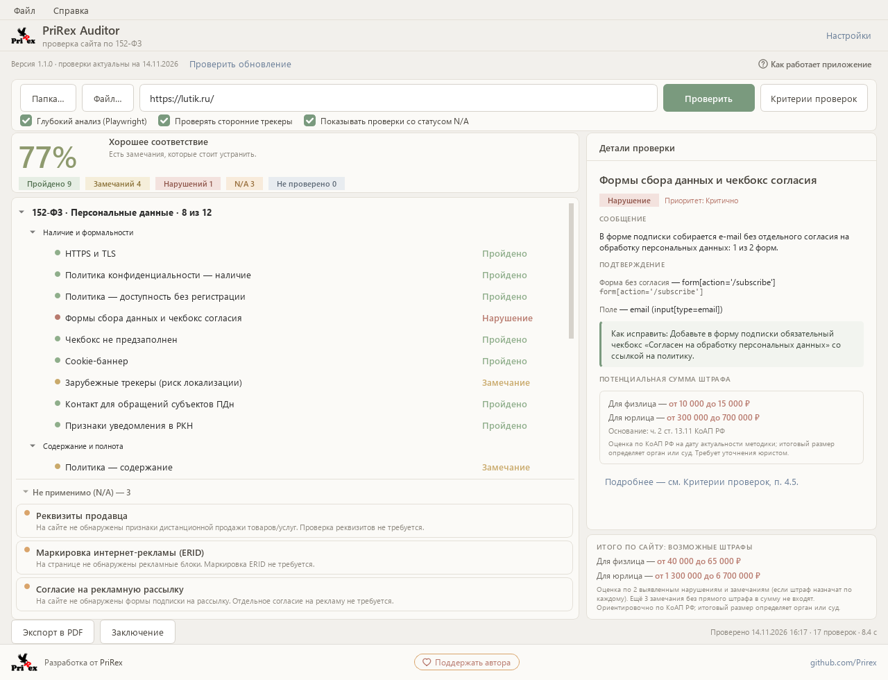
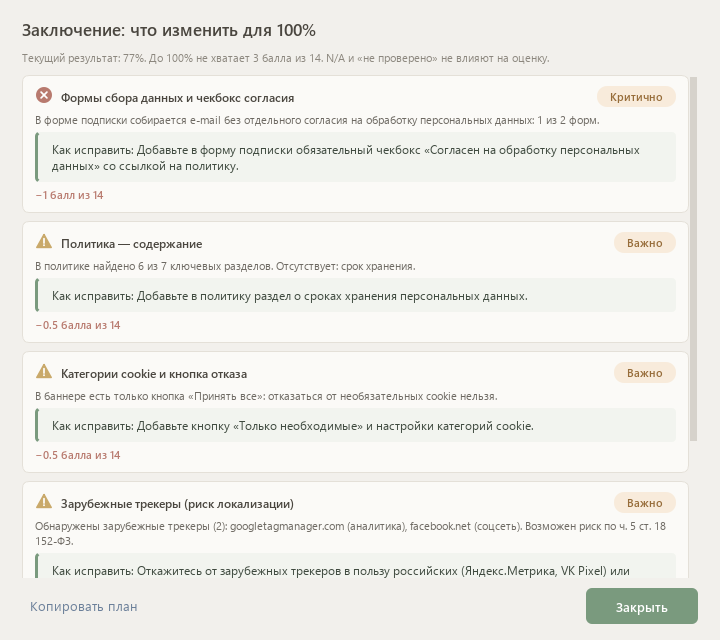
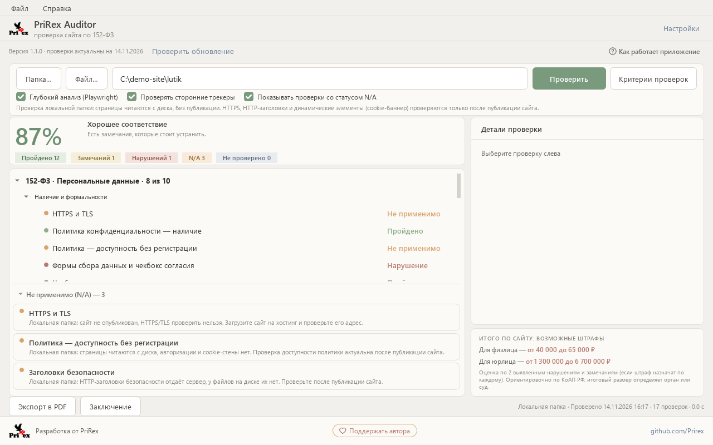
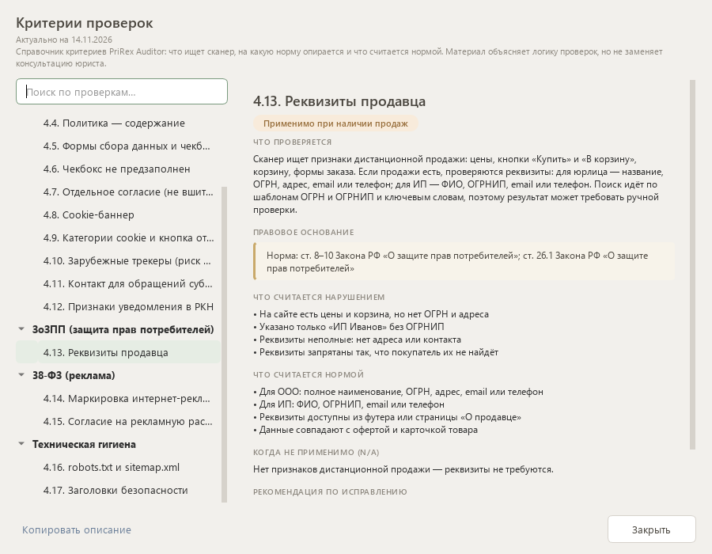
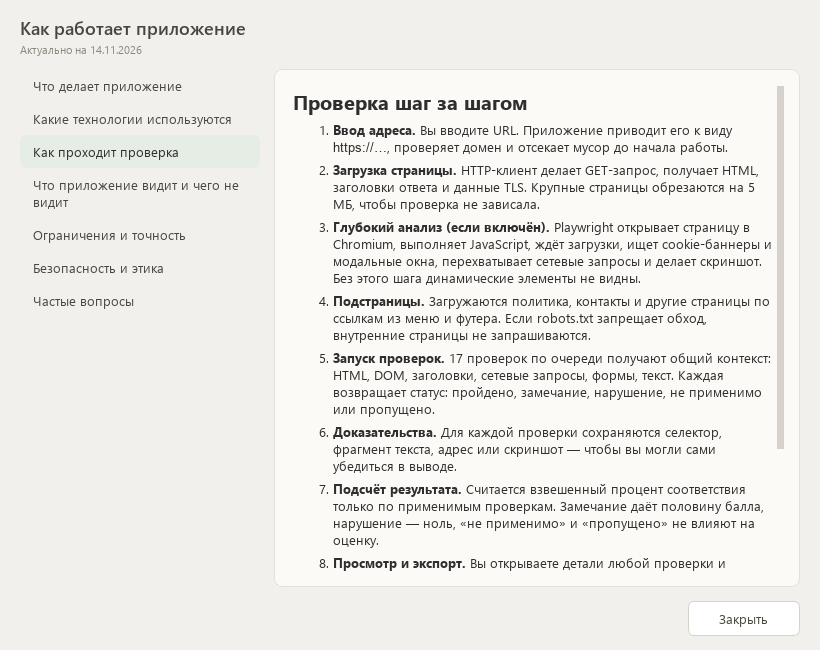
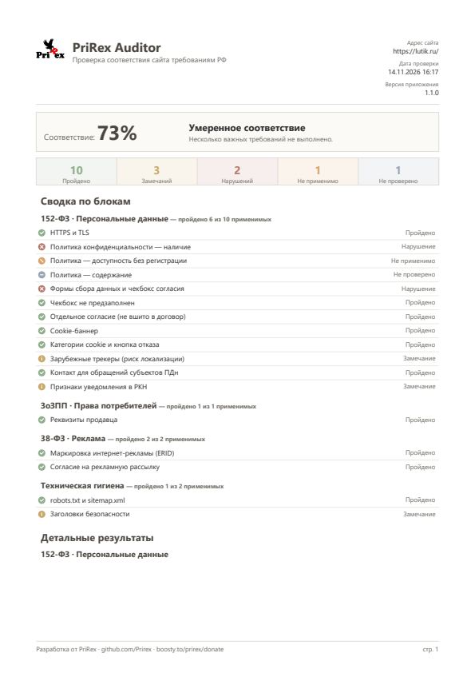
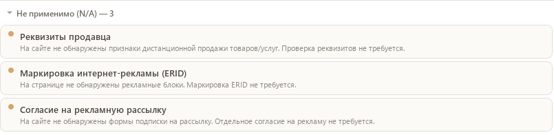

# PriRex Auditor

**Проверка сайта на соответствие требованиям РФ: 152-ФЗ (персональные данные),
ЗоЗПП (права потребителей), 38-ФЗ (реклама) и техническая гигиена.**

[](https://github.com/Prirex/PriRex-Auditor/releases/latest)
[](#быстрый-старт)
[](https://www.python.org/)
[](LICENSE)
[](#тесты)
[](https://github.com/Prirex/PriRex-Auditor/actions/workflows/build.yml)

Офлайн-утилита для Windows: вводите адрес сайта (или указываете локальную папку
с сайтом), нажимаете «Проверить» — получаете отчёт с процентом соответствия,
нарушениями по приоритету и пояснениями. Все проверки детерминированные:
правила, эвристики и регулярные выражения, без ИИ внутри.

> ⚠️ **Дисклеймер.** Это автоматическая эвристическая проверка. Она не заменяет
> аудит юриста и не гарантирует отсутствие претензий Роскомнадзора,
> Роспотребнадзора или ФАС.

**Скачать:** [PriRex Auditor 1.1.0 для Windows](https://github.com/Prirex/PriRex-Auditor/releases/latest)

---

## Возможности

- **17 проверок** по четырём блокам: 152-ФЗ, ЗоЗПП, 38-ФЗ и техническая
  гигиена. Одинаковый результат при одинаковом вводе.
- **Процент соответствия** считается только по применимым проверкам;
  N/A и «не удалось проверить» в знаменатель не входят. Проверки сгруппированы
  в подразделы «Наличие и формальности» и «Содержание и полнота».
- **Секция «Не применимо (N/A)»** — для каждой пропущенной проверки видно
  полное пояснение, почему она не относится к сайту.
- **Кнопка «Заключение»** — что исправить, чтобы выйти на 100%: приоритет,
  потерянные баллы, готовый план для копирования.
- **Потенциальная сумма штрафа** — по каждой проверке (для физлица и юрлица,
  со ссылкой на статью КоАП) и **итог по всему сайту**.
- **Справочник «Критерии проверок»** — что и на основании какой нормы
  проверяется, что считается нарушением и нормой, когда проверка не применима,
  как исправить. Поиск по всем текстам, копирование описания.
- **Окно «Как работает приложение»** — технологии, пошаговая механика, что
  сканер видит и чего не видит, ограничения, безопасность, FAQ.
- **Проверка локальной папки или файла** — до публикации сайта: `C:\sites\lutik`,
  `…\index.html`, файл без расширения `index`, `file:///…`; кнопки «Папка…» и
  «Файл…». Читаются страницы политики/контактов, `robots.txt`, `sitemap.xml`.
- **Глубокий анализ (Playwright/Chromium)** — рендер страницы, cookie-баннер,
  сетевые запросы, скриншот. Без браузера — аккуратный откат на `httpx` + BS4.
- **Экспорт**: PDF, самодостаточный HTML, Markdown (чек-лист + методология),
  JSON. Во всех форматах брендинг и сноски на критерии проверок.
- **Версия и актуальность методики** в тулбаре + ручная проверка обновлений
  без GitHub API и токенов.
- **Настройки**, журнал, опциональное подтверждение перед Boosty. Русский
  интерфейс, заготовка локализации.
- **Приватность**: всё локально, без телеметрии и регистрации; только GET-запросы;
  robots.txt уважается при обходе подстраниц.

## Скриншоты

| Главное окно | Детали проверки и штрафы |
| --- | --- |
|  |  |

| Заключение: что изменить для 100% | Проверка локальной папки |
| --- | --- |
|  |  |

| Критерии проверок | Как работает приложение |
| --- | --- |
|  |  |

| Отчёт PDF | Секция «Не применимо (N/A)» |
| --- | --- |
|  |  |

## Быстрый старт

### Готовый файл для Windows

1. Скачайте `PriRex-Auditor-1.1.0.exe` со страницы
   [Releases](https://github.com/Prirex/PriRex-Auditor/releases/latest).
2. Запустите. Файл не подписан цифровой подписью, поэтому Windows может
   показать SmartScreen — «Подробнее» → «Выполнить в любом случае».
3. Для глубокого анализа (cookie-баннер, динамика) нужен Chromium Playwright
   или установленный Google Chrome / Microsoft Edge. Без браузера приложение
   честно предупредит и проверит только статический HTML.

### Из исходников

Нужен Python 3.11+ (проверено на 3.14) и Windows 10/11.

```powershell
git clone https://github.com/Prirex/PriRex-Auditor.git
cd PriRex-Auditor

python -m venv .venv
.venv\Scripts\Activate.ps1
pip install -r requirements.txt

# логотип и иконка (только при изменении assets/logo.svg)
python tools/make_assets.py

python main.py
```

Chromium для глубокого анализа:

```powershell
python -m playwright install chromium
```

## Как пользоваться

1. Введите адрес: `example.com`, `https://example.com` или IP. Схема `https://`
   подставляется автоматически.
2. Либо проверьте **локальную папку/файл** сайта: `C:\sites\lutik`,
   `…\index.html`, `…\index` — или выберите кнопками «Папка…» / «Файл…».
3. При необходимости измените чекбоксы: глубокий анализ, сторонние трекеры,
   показ N/A.
4. «Проверить». Прогресс показывает текущий шаг, проверку можно отменить.
5. Клик по проверке — справа детали: сообщение, подтверждение (селекторы,
   URL), рекомендация, потенциальный штраф. Двойной клик или «Подробнее…» —
   справочник на этой проверке.
6. «Заключение» — план исправлений до 100%. «Экспорт в PDF» — на нижней панели,
   остальные форматы — в меню «Файл».
7. Справка: «Критерии проверок» рядом с полем URL, «? Как работает приложение»
   справа в тулбаре.

Настройки: «Файл → Настройки», хранятся в
`%APPDATA%\PriRex Auditor\config.json`; журнал — в
`%APPDATA%\PriRex Auditor\logs\app.log`.

## Проверки

| Блок | ID | Проверка | Вес |
| --- | --- | --- | --- |
| 152-ФЗ | `a01_https` | HTTPS и TLS (валидный сертификат, TLS ≥ 1.2) | 10 |
| 152-ФЗ | `a02_privacy_link` | Ссылка на политику конфиденциальности в футере | 9 |
| 152-ФЗ | `a03_privacy_access` | Политика доступна без авторизации и cookie-стены | 5 |
| 152-ФЗ | `a04_privacy_content` | Содержание политики (7 маркеров) | 7 |
| 152-ФЗ | `a05_forms_consent` | Формы сбора ПДн и чекбокс согласия | 8 |
| 152-ФЗ | `a06_consent_prechecked` | Чекбокс согласия не предзаполнен | 4 |
| 152-ФЗ | `a07_separate_consent` | Отдельное согласие (не вшито в оферту) | 4 |
| 152-ФЗ | `a08_cookie_banner` | Cookie-баннер при наличии трекеров | 5 |
| 152-ФЗ | `a09_cookie_categories` | Категории cookie и кнопка отказа | 3 |
| 152-ФЗ | `a10_foreign_trackers` | Зарубежные трекеры (риск локализации) | 3 |
| 152-ФЗ | `a11_pdn_contact` | Контакт для обращений субъектов ПДн | 5 |
| 152-ФЗ | `a12_rkn_notice` | Признаки уведомления в РКН (подсказка) | 2 |
| ЗоЗПП | `b13_seller_details` | Реквизиты продавца (ОГРН/ОГРНИП, адрес, контакты) | 8 |
| 38-ФЗ | `c14_erid` | Маркировка рекламы: пометка «Реклама» + токен erid | 6 |
| 38-ФЗ | `c15_ad_consent` | Отдельное согласие на рекламную рассылку | 5 |
| Тех. | `d16_robots_sitemap` | robots.txt и sitemap.xml | 2 |
| Тех. | `d17_security_headers` | X-Frame-Options/CSP, nosniff, Referrer-Policy | 3 |

Процент = взвешенная доля пройденных проверок: «замечание» даёт половину очков,
N/A и skip исключаются из знаменателя. Описание каждой проверки, нормы, примеры
нарушений и рекомендации — в окне «Критерии проверок» и в
[`assets/methodology.json`](assets/methodology.json).

## Приватность и этика

- Только GET-запросы, сайт не изменяется.
- Авторизация, капчи и Cloudflare-челленджи не обходятся.
- robots.txt уважается при обходе подстраниц.
- Содержимое страниц не сохраняется, кроме скриншотов для отчёта.
- URL, настройки и отчёты хранятся только на вашем компьютере.
- Никакой телеметрии и сторонних API, персональные данные посетителей не
  собираются.
- Уведомление о новой версии — без автоскачивания, сетевые ошибки игнорируются.

## Сборка

```powershell
powershell -ExecutionPolicy Bypass -File build.ps1
```

Скрипт прогоняет тесты, собирает `--onefile --windowed` через PyInstaller и
кладёт готовый `PriRex Auditor.exe` в корень проекта. Вручную:

```powershell
python -m PyInstaller "PriRex Auditor.spec" --noconfirm
```

В бандл через `--add-data` попадают логотип, иконка, QSS-тема и JSON-справочники
(читаются через `sys._MEIPASS`). GitHub Actions
([`.github/workflows/build.yml`](.github/workflows/build.yml)) прогоняет тесты на
каждый push и собирает exe; по тегу `v*` публикует релиз с артефактом.

## Тесты

```powershell
python -m pytest
```

297 тестов: проверки на синтетическом контексте, разбор HTML, детекторы,
применимость (сайт без продаж → N/A, а не fail), скоринг, экспорт во все
форматы, обновления, справочники, локальная проверка, UI в offscreen-режиме и
сквозные сценарии. Три интеграционных теста с реальными сайтами отключены по
умолчанию (`RUN_NETWORK_TESTS=1`).

Скриншоты для документации: `python tools/make_docs_screenshots.py`.

## Структура проекта

```
main.py                      — точка входа
PriRex Auditor.spec          — PyInstaller
build.ps1                    — сборка одной командой
app/
  core/
    models.py                — SiteContext, CheckResult, Report, разделы
    detect.py                — регулярки, словари, эвристики
    checks/                  — 17 проверок (auto-discovery по id)
    engine/                  — реестр, скоринг, оркестратор, штрафы
    content/                 — модели и загрузчик JSON-справочников
  services/
    http/                    — httpx-клиент, TLS-информация
    browser/                 — Playwright-обёртка
    site_context.py          — сбор контекста (HTTP + BS4 + Chromium)
    local_target.py          — разбор локального пути
    local_context.py         — проверка локальной папки
    targets.py               — разбор поля адреса (URL или путь)
    report/                  — экспорт PDF/HTML/MD/JSON
  ui/                        — главное окно, дерево, футер, тема, диалоги,
                               methodology_window.py, how_it_works_window.py,
                               conclusion_dialog.py, fine_summary.py
  updater/                   — проверка обновлений по version.json / тегу
assets/                      — логотип, иконка, QSS, SVG-иконки,
                               methodology.json, how_it_works.json
docs/                        — скриншоты для README
tests/                       — pytest
tools/                       — генераторы активов, скриншотов, e2e
```

## Обновления

Без GitHub API и токенов: приложение сверяет установленную версию с
[`version.json`](version.json) в этом репозитории (и резервно — с тегом
`releases/latest`). Проверка не чаще раза в 24 часа; кнопка «Проверить
обновление» в тулбаре делает это по запросу. Скачивание — только по ссылке и
только по клику.

## Ограничения

- Проверка эвристическая: находит формальные признаки, а не правонарушения;
  возможны ложные срабатывания и пропуски.
- Cloudflare/DDoS-Guard и капчи не обходятся.
- Проверяется главная страница и несколько подстраниц (политика, контакты,
  оферта), а не весь сайт.
- В локальном режиме HTTPS, HTTP-заголовки и динамика недоступны до публикации.
- Суммы штрафов — ориентировочная оценка по КоАП РФ; итоговый размер определяет
  орган или суд.

## Поддержать автора

Если приложение полезно: [Boosty](https://boosty.to/prirex/donate).
Кнопка есть в футере, в «О программе» и в меню «Справка».

## Лицензия

[MIT](LICENSE) © 2026 PriRex

---

Разработка от **PriRex** · [github.com/Prirex](https://github.com/Prirex)

`#152ФЗ` `#персональныеданные` `#ЗоЗПП` `#реклама` `#ERID` `#Python` `#PySide6`
`#Windows` `#сайт` `#аудит` `#приватность`
